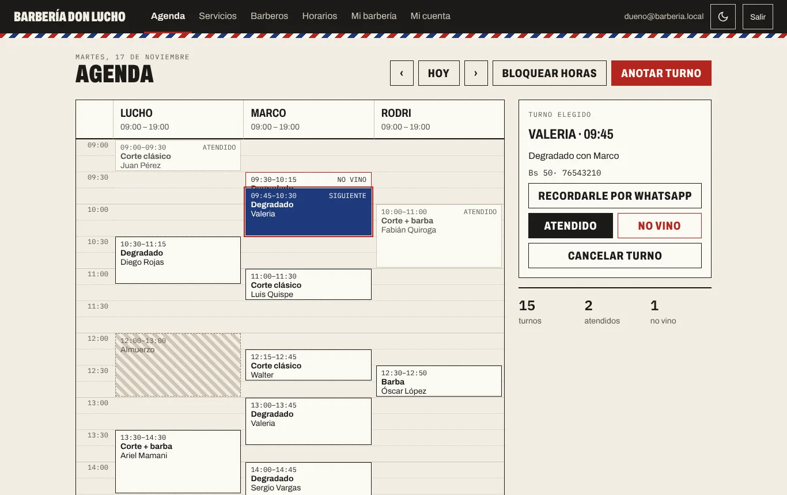

# Barbería

Sistema de reservas para barberías: los clientes conocen la barbería en una portada con un poste en 3D y sacan turno desde el celular, sin crear cuenta, y el equipo administra la agenda, los horarios y los servicios desde un panel.

## Capturas

<p>
  
  
  
</p>



Todas las pantallas, paso a paso, en el [manual de usuario](docs/manual.md).

## Estado

| Versión | Contenido |
|---|---|
| 1.0 | Reserva desde el celular, turno con enlace para cambiar o cancelar, agenda del panel, servicios, barberos, horarios, bloqueos y avisos por correo |
| 1.1 | Presentación con poste en 3D, paletas y modo oscuro, recordar datos del cliente, cambio de contraseñas, logo y fotos, recordatorio antes del turno y revisión de seguridad |

## Documentos

- [Manual de usuario](docs/manual.md)
- [Qué hace el sistema](docs/sistema.md)
- [Arquitectura](docs/arquitectura.md)
- [Reglas de desarrollo](reglas.md)
- [Despliegue](docs/despliegue.md)
- [Seguridad](docs/seguridad.md)

## Tecnologías

| Parte | Tecnología |
|---|---|
| API | .NET 10, ASP.NET Core, EF Core |
| Web | SvelteKit con TypeScript |
| Base de datos | PostgreSQL (Supabase en producción) |
| Pruebas | xUnit, NetArchTest, Testcontainers, Vitest, Testing Library y Playwright |
| Calidad | `dotnet format`, ESLint, knip y pruebas de arquitectura |

## Configuración

La API lee su configuración de `appsettings.json` o de variables de entorno (con `__` en lugar de `:`):

| Variable | Para qué |
|---|---|
| `ConnectionStrings__Barberia` | Cadena de conexión a PostgreSQL |
| `Jwt__Key` | Clave secreta de al menos 32 caracteres para firmar las sesiones |
| `Setup__ShopName` | Nombre de la barbería al arrancar por primera vez |
| `Setup__OwnerEmail` y `Setup__OwnerPassword` | Cuenta del dueño que se crea al primer arranque |
| `Cors__Origins__0` | Dirección de la web que puede llamar a la API |
| `Email__BrevoApiKey` | Clave de Brevo para mandar las confirmaciones por correo; sin ella no se envían correos |
| `Email__SenderEmail` y `Email__SenderName` | Remitente de los correos, verificado en Brevo |
| `Email__PublicWebUrl` | Dirección pública de la web, para el enlace del turno en el correo |

En desarrollo ya vienen valores locales en `appsettings.Development.json`: el dueño es `dueno@barberia.local` con la contraseña `barberia-local`. Para empezar con servicios, barberos y horarios de ejemplo, arranca la API con `Setup__DemoData=true`.

Reservar, cambiar turnos e iniciar sesión tienen un límite de peticiones por dirección IP (`RateLimits__PermitsPerMinute`, 20 por minuto por defecto).

## Desarrollo

Requisitos: .NET SDK 10, Node 22 y Docker.

```bash
# Base de datos local
docker compose up -d

# API en http://localhost:5000
cd backend
dotnet run --project src/Barberia.Api

# Web en http://localhost:5173 (reservas en /, panel en /ingresar)
cd frontend
npm install
npm run dev
```

La web busca la API en `VITE_API_URL`; si no está definida usa `http://localhost:5000`.

| Tarea | Backend (`backend/`) | Frontend (`frontend/`) |
|---|---|---|
| Pruebas | `dotnet test` | `npm test` |
| Formato y estilo | `dotnet format` | `npm run lint:fix` |
| Código sin uso | se revisa al compilar | `npm run lint:deadcode` |
| Tipos | `dotnet build` | `npm run check` |
| Punta a punta | (con la API y la web levantadas) | `npm run test:e2e` |
