# Manual de usuario

Cómo se usa Barbería: primero lo que hace el cliente desde su celular y después lo que hacen el dueño y los barberos desde el panel.

## Quién entra a dónde

| Quién | Dónde | Necesita cuenta |
|---|---|---|
| Cliente | La página de la barbería (`/`) y la reserva (`/reservar`) | No. Deja su nombre y celular al reservar |
| Cliente con turno | El enlace de su turno (`/turno/...`) | No. El enlace es secreto y solo lo tiene él |
| Dueño | El panel, entrando por `/ingresar` | Sí. La crea el sistema al instalarlo |
| Barbero | Su agenda en el panel, entrando por `/ingresar` | Sí, si el dueño le da acceso |

---

## Parte 1. El cliente

### 1. Conocer la barbería

La página de inicio presenta la barbería: el nombre, el logo, si está abierta en este momento y un poste de barbería en 3D que se mueve al inclinar el teléfono. Más abajo están los precios, el equipo, las fotos del local, el horario de la semana con el día de hoy marcado y la ubicación.

  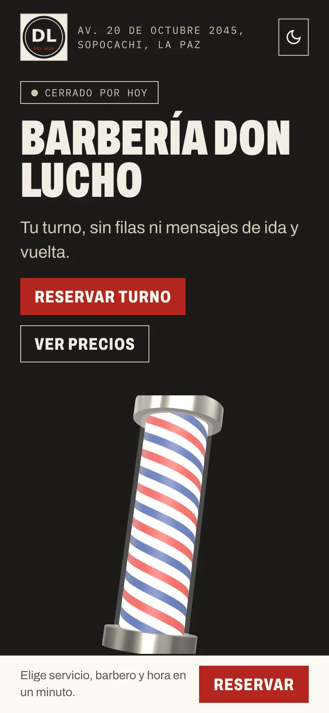
  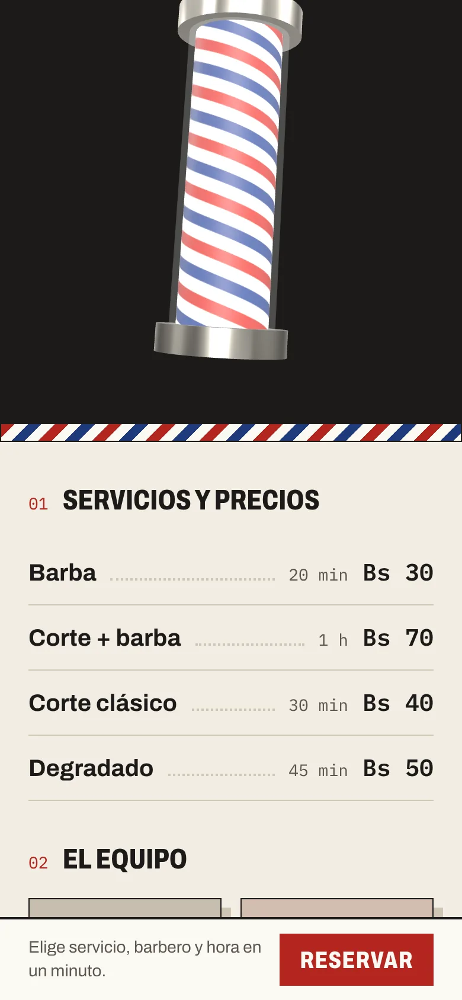

- **Reservar turno** lleva a la reserva. El mismo botón queda fijo abajo mientras se baja por la página.
- **Ver precios** baja hasta la lista de servicios.
- **Cómo llegar** abre Google Maps con la dirección y **WhatsApp** abre un chat con la barbería.
- El botón de **luna o sol** de arriba cambia entre modo claro y oscuro (ver el punto 6).

### 2. Reservar un turno

La reserva tiene cuatro pasos en una sola página. Abajo siempre se ve el resumen: qué se eligió, la hora y el precio.

  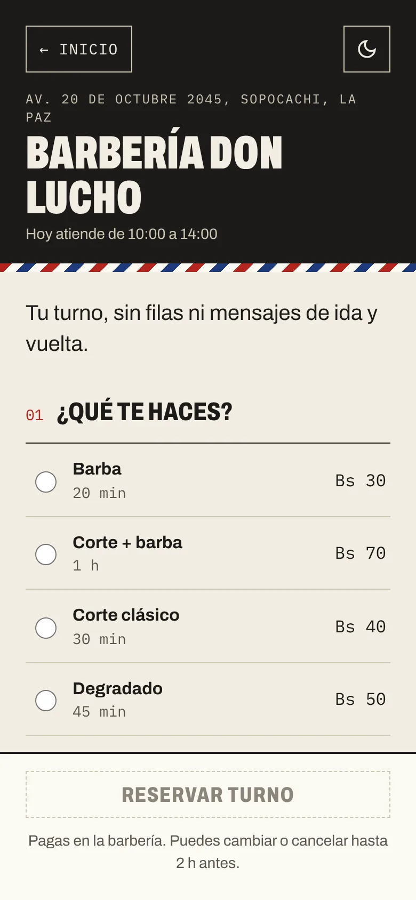
  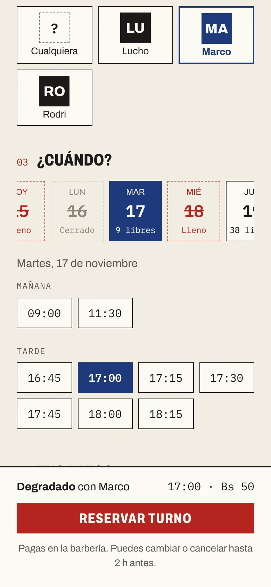
  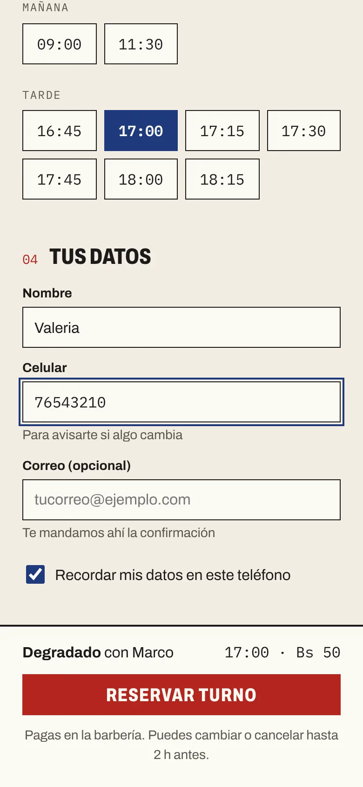

1. **¿Qué te haces?** Se elige el servicio. Cada uno muestra cuánto dura y cuánto cuesta.
2. **¿Con quién?** Se elige un barbero o **Cualquiera**. Con "Cualquiera" el turno va al barbero libre que tenga menos turnos ese día.
3. **¿Cuándo?** Se elige el día en la tira de fechas y después la hora. Bajo cada día se ve su estado:
   - **Cerrado** (tachado en gris): la barbería no abre ese día.
   - **Lleno** (tachado en rojo): ya no queda ninguna hora. Se marca desde que se abre la página, sin elegir nada, si no entra ni el servicio más corto.
   - **N libres**: una vez elegidos el servicio y el barbero, cuántas horas de inicio le quedan a ese día.

   Si el día que estaba elegido se llena para el servicio que se eligió, la página pasa sola al primer día con lugar. Solo se muestran las horas en las que el servicio entra completo.
4. **Tus datos.** Nombre y celular son obligatorios; el correo es opcional y sirve para recibir la confirmación y el recordatorio.

Al tocar **Reservar turno** el turno queda guardado. Si justo otra persona tomó esa hora, la página lo avisa y muestra las horas que siguen libres.

**Recordar mis datos en este teléfono** viene marcado: la próxima vez el nombre y el celular aparecen escritos. Se guardan solo en el teléfono del cliente; si lo desmarca, se borran al reservar.

### 3. Mi turno

Después de reservar aparece el turno como un talón, con su número, el servicio, el barbero, el día, la hora y el precio. **Ese enlace es la llave del turno**: con él se puede volver a verlo, cambiarlo o cancelarlo, así que conviene guardarlo.

  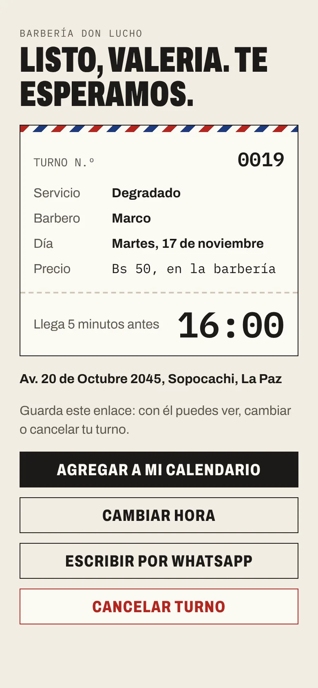
  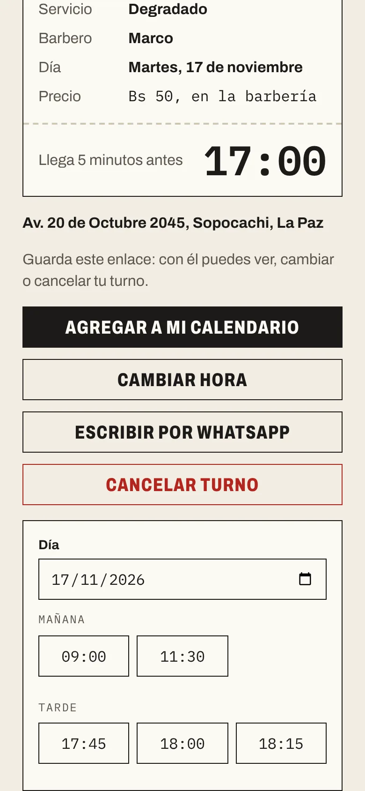

- **Agregar a mi calendario** descarga el turno para el calendario del teléfono.
- **Cambiar hora** muestra las horas libres para elegir otra, el mismo día u otro.
- **Escribir por WhatsApp** abre un chat con la barbería con el número del turno ya escrito.
- **Cancelar turno** pide confirmación antes de cancelar.

Cambiar y cancelar se pueden hacer hasta el plazo que puso la barbería (por ejemplo, 2 horas antes). Pasado ese plazo hay que llamar o escribir a la barbería.

### 4. Avisos por correo

Si el cliente dejó correo, recibe un mensaje al reservar, al cambiar la hora y al cancelar, y **un recordatorio unas horas antes del turno** (3 horas antes, salvo que la barbería lo cambie). El recordatorio llega una sola vez; si cambia la hora, llega otro para la hora nueva.

### 5. Pagar

El pago es en la barbería, como siempre. La página no pide tarjeta.

### 6. Modo oscuro

El botón de **luna o sol** cambia entre claro y oscuro. Al principio la página sigue lo que tenga configurado el teléfono; después recuerda lo que eligió cada persona.

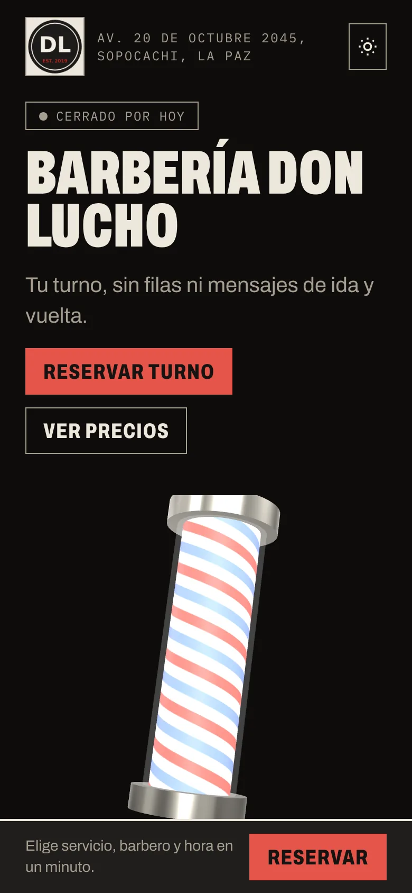

---

## Parte 2. El dueño y los barberos

El panel está pensado para usarse en la computadora del local, pero también funciona en el celular.

### 7. Ingresar

Se entra por `/ingresar` con el correo y la contraseña. El dueño ve todo el panel; un barbero solo ve **Mi agenda** y **Mi cuenta**.

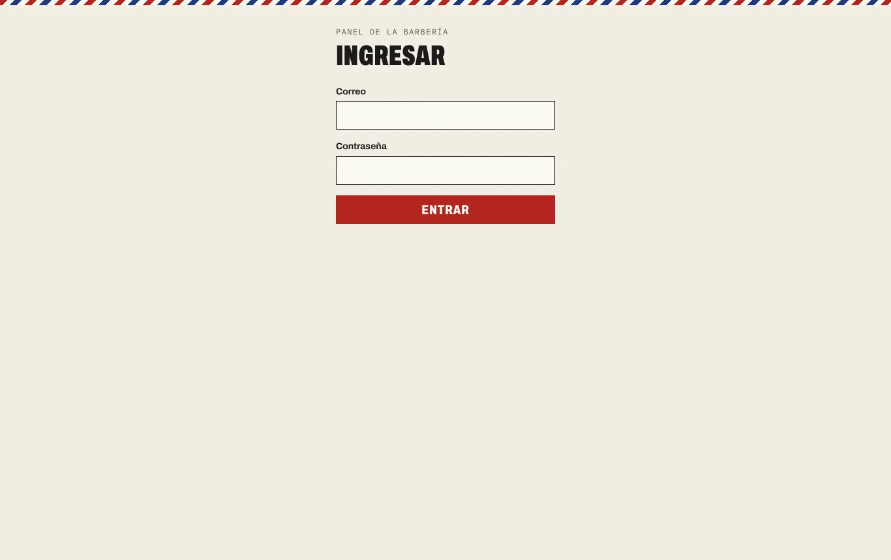

La sesión dura 12 horas. Se cierra antes si alguien cambia la contraseña o si el dueño da de baja al barbero.

### 8. Agenda

La agenda muestra un día con una columna por barbero. Cada turno dice la hora, el servicio y el cliente. Las horas rayadas están bloqueadas y la línea roja marca la hora actual.

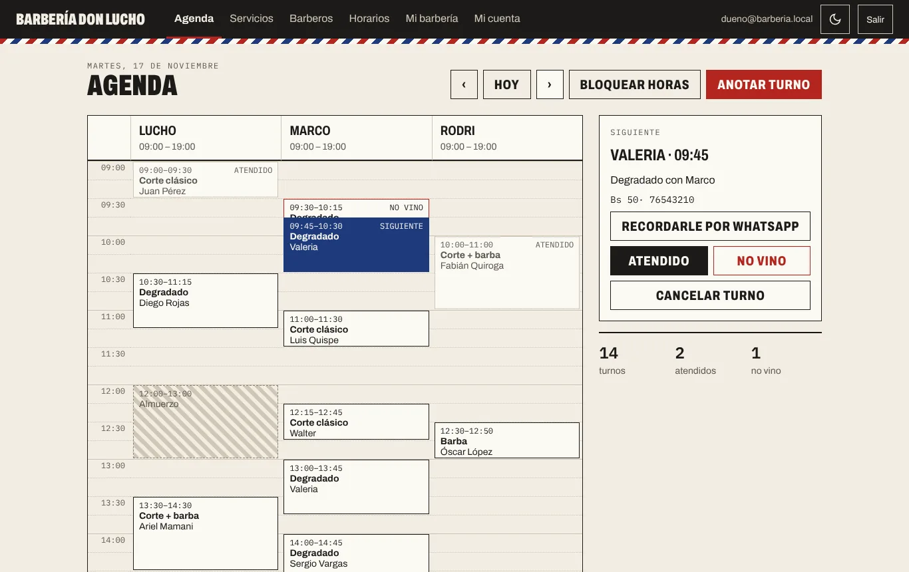

- **‹ Hoy ›** pasa al día anterior, vuelve a hoy o pasa al siguiente.
- A la derecha aparece el **siguiente turno** del día y, abajo, cuántos turnos hay, cuántos se atendieron y cuántos no vinieron.

Al tocar un turno se abre su ficha:

- **Recordarle por WhatsApp** abre un chat con el cliente con el mensaje listo.
- **Atendido** o **No vino** cierra el turno; **Deshacer** lo devuelve a reservado si fue un error.
- **Cancelar turno** libera la hora y le avisa al cliente por correo, si lo dejó.

**Anotar turno** sirve para quien llama por teléfono o llega sin reserva. Si llegó sin reserva, el celular es opcional.

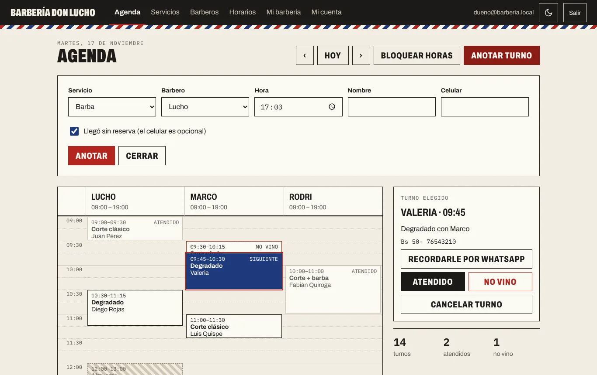

**Bloquear horas** cierra un rato en la agenda de un barbero, por ejemplo para almorzar. Nadie puede reservar en esas horas. Para quitarlo, se toca el bloqueo en la agenda y **Quitar bloqueo**.

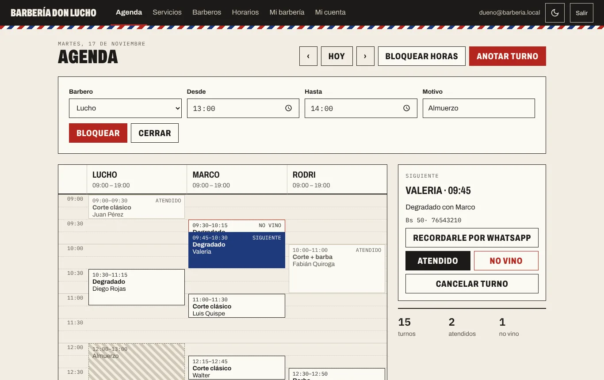

Un barbero ve y maneja solo su propia agenda.

### 9. Servicios (solo el dueño)

Lista de servicios con su duración y precio. **Nuevo servicio** agrega uno; tocar uno lo edita. Si se desmarca **Se muestra a los clientes**, el servicio queda oculto en la reserva pero los turnos que ya tenía se mantienen.

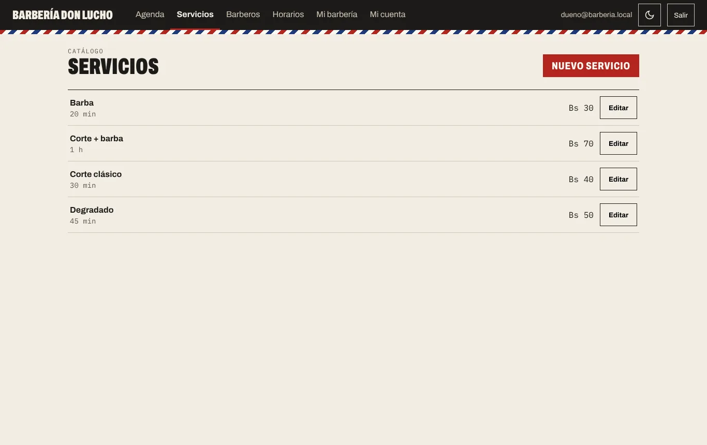

### 10. Barberos (solo el dueño)

A la izquierda está el equipo; al tocar a alguien se abre su ficha.

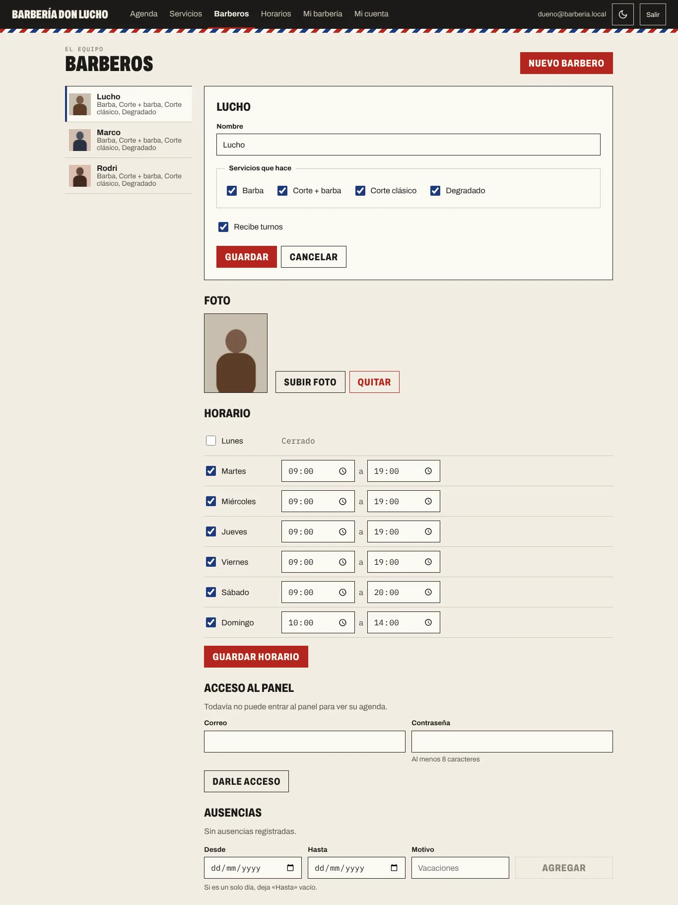

- **Datos:** nombre, servicios que hace y si **recibe turnos**. Un barbero que no recibe turnos deja de aparecer en la reserva y, si tenía acceso al panel, ya no puede entrar.
- **Foto:** aparece en la página de la barbería. Si no tiene, se muestran sus iniciales.
- **Horario:** los días y horas en que trabaja, siempre dentro del horario de la barbería.
- **Acceso al panel:** si todavía no puede entrar, se le pone correo y contraseña. Si olvidó su contraseña, aquí se le pone una nueva.
- **Ausencias:** vacaciones o días libres. Esos días no recibe turnos.

### 11. Horarios (solo el dueño)

El **horario de atención** de cada día de la semana y los **días cerrados**, como feriados. Los días cerrados aparecen tachados en la reserva.

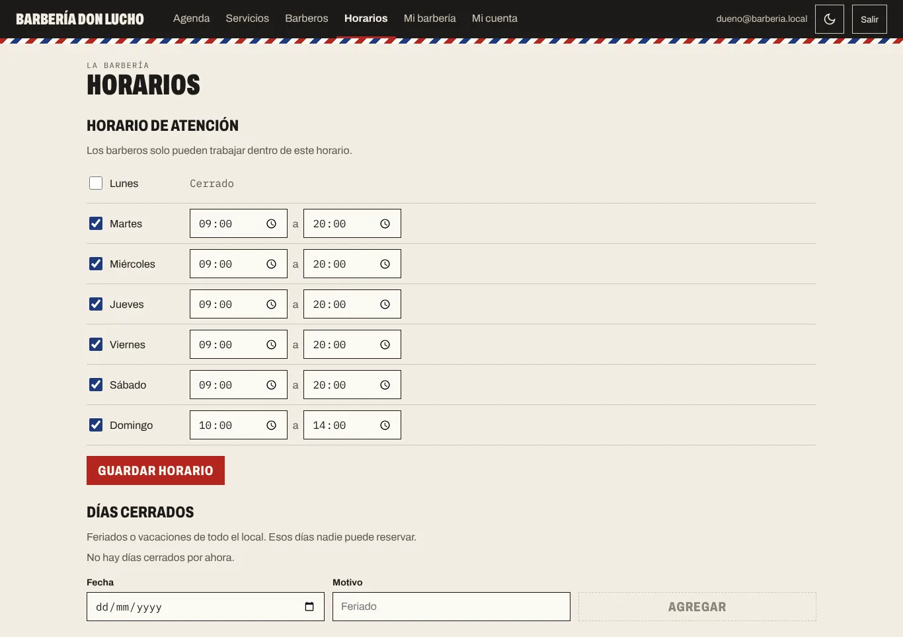

### 12. Mi barbería (solo el dueño)

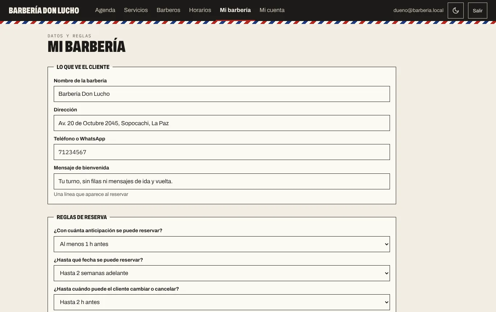

- **Lo que ve el cliente:** nombre, dirección, teléfono o WhatsApp y un mensaje de bienvenida.
- **Reglas de reserva:** con cuánta anticipación se puede reservar, hasta qué fecha, hasta cuándo el cliente puede cambiar o cancelar y **cada cuánto empiezan los turnos** (cada 15, 20, 30 o 60 minutos). Cada turno ocupa lo que dura su servicio; el intervalo solo decide a qué horas puede empezar. Con servicios de 30 o 60 minutos, "cada 30 minutos" deja horas redondas (9:00, 9:30, 10:00…) sin perder tiempo entre turnos.
- **Colores:** cinco paletas. Cada tarjeta muestra cómo se ve la página con esos colores. Se aplican a todas las páginas al tocar **Guardar cambios**.

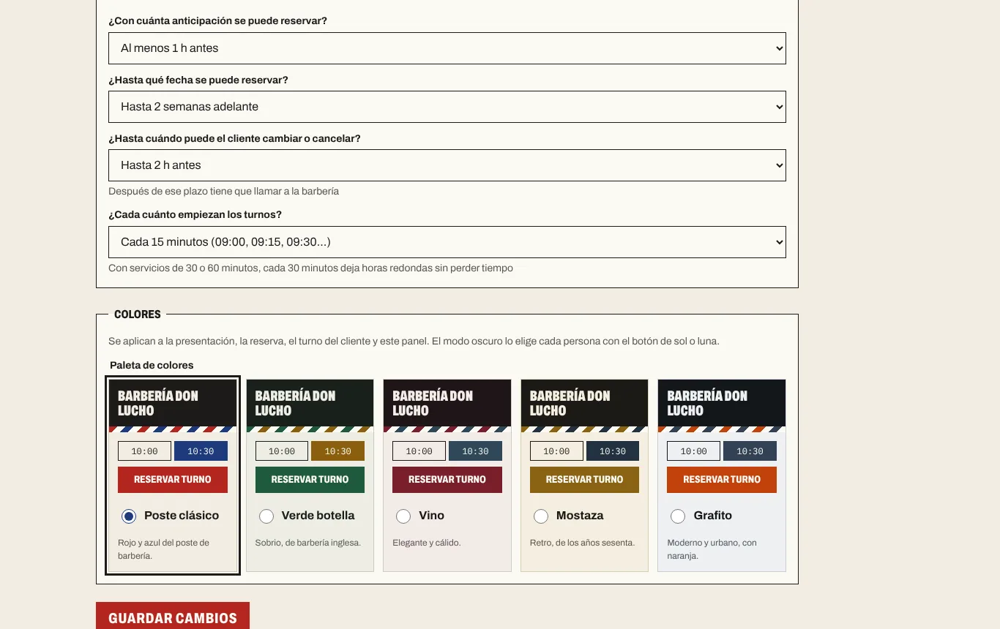

- **Logo y fotos:** el logo y hasta 6 fotos del local, que aparecen en la página de la barbería. Se guardan al elegirlas, sin tocar "Guardar cambios". Las fotos se achican en el teléfono antes de subirlas para que la página cargue rápido.

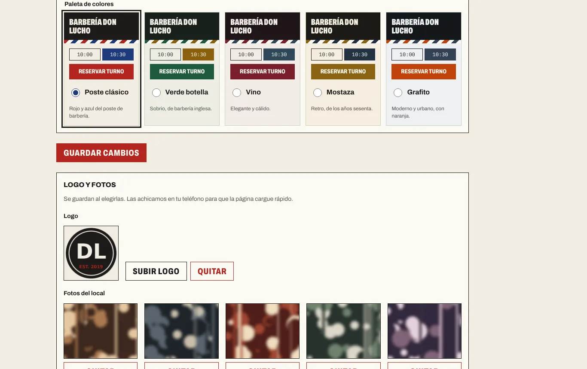

### 13. Mi cuenta

Cada uno cambia aquí su propia contraseña: la actual, la nueva y repetirla. Al cambiarla se cierran las sesiones abiertas en otros equipos.

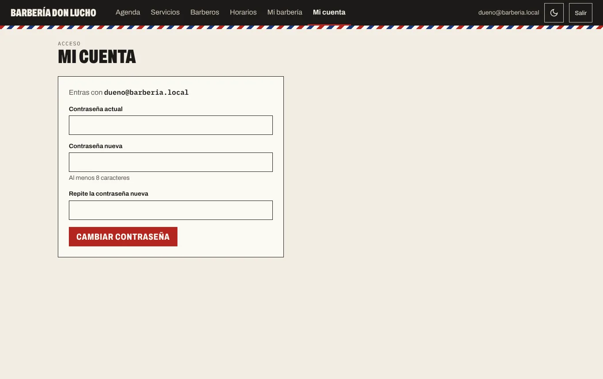

---

## Preguntas frecuentes

**Un cliente perdió el enlace de su turno.** Si dejó correo, lo tiene en la confirmación. Si no, la barbería ve el turno en la agenda y puede cambiarlo o cancelarlo desde ahí.

**Un barbero olvidó su contraseña.** El dueño le pone una nueva en Barberos → Acceso al panel.

**El dueño olvidó su contraseña.** Se cambia la variable `Setup__OwnerPassword` en el servidor solo la primera vez; después hay que pedir ayuda técnica para restablecerla. Por eso conviene cambiarla en Mi cuenta por una que se recuerde.

**¿Por qué no aparece una hora?** Porque ya pasó o no cumple la anticipación mínima, porque está ocupada o bloqueada, porque el servicio no entra completo antes del siguiente turno o del cierre, porque no coincide con el intervalo de turnos que eligió la barbería o porque el barbero está ausente ese día.

**No llegan los correos.** La barbería tiene que tener configurado el envío de correos (ver [Despliegue](despliegue.md)). Sin eso todo funciona igual, salvo los correos.
